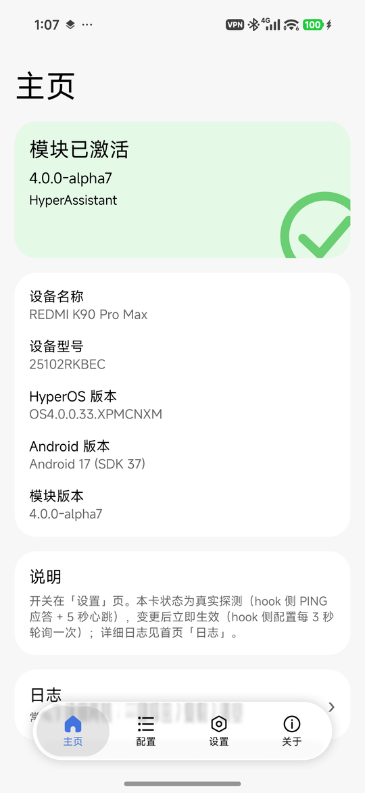
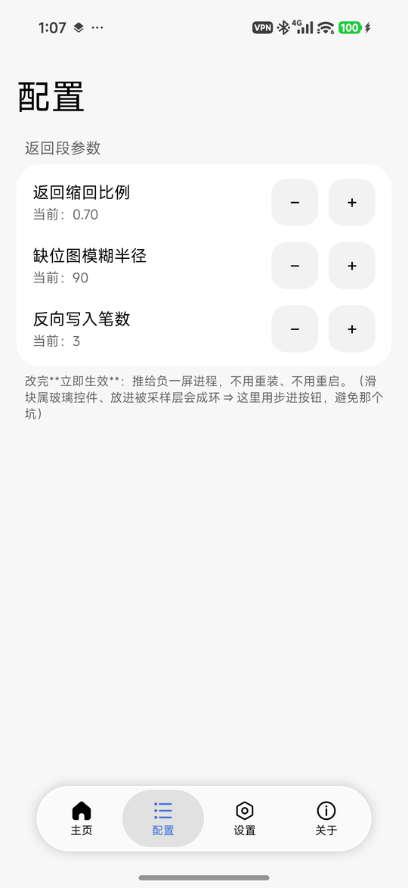
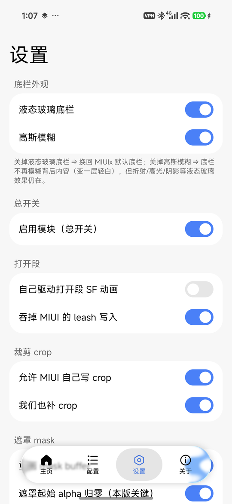
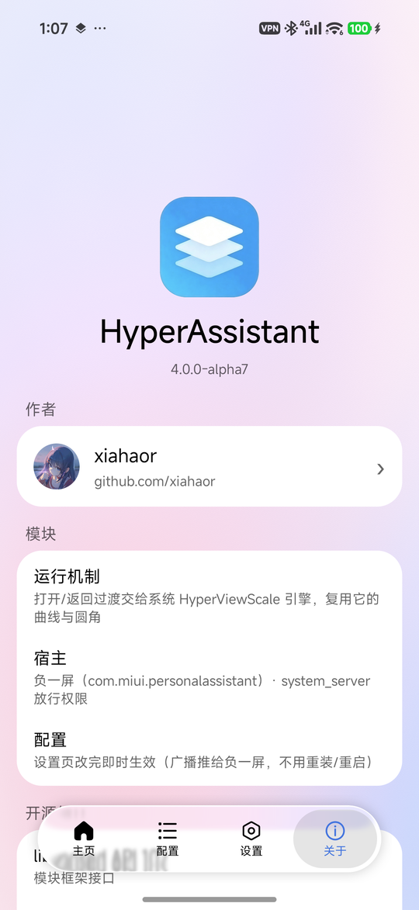

# HyperAssistant


> 给小米澎湃 OS（HyperOS 4）的「**负一屏**」加上**打开 / 返回过渡动画**的 LSPosed 模块。

**一句话原理**：不自己画动画，而是 hook 系统自己的 **HyperViewScale**（SurfaceFlinger 过渡）引擎，
复用它的曲线、圆角与速度，并让它**可打断**。

- 宿主：负一屏 `com.miui.personalassistant`
- 框架：**libxposed API 102**（LSPosed）
- 界面：Jetpack Compose + MIUIx

---

## 特性

- **卡片 → 应用**：从卡片原位放大展开（走系统 HVS 过渡，不是自己贴图）
- **返回方向**：交回系统引擎 + 本模块的返回段策略（可开关）
- **App 内 20 个开关可运行期调节**：改完**立即生效**，不用重装、不用重启
- **关于页「流光溢彩」背景**（AGSL 运行期着色器）：下滑渐隐为白，离开关于页自动停止渲染
- **激活状态真实检测**：App 与宿主之间有 PING/PONG 心跳，不是"看模块列表猜"
- **日志可导出**：一键写进 `Download/dsh-debuglog/`，也可复制到剪贴板
- **所有结论都有出处**：`docs/逆向数据与经验.md` 记录了接口签名、结构数据、踩坑与未解问题

## 截图

| 主页（激活状态 / 设备信息 / 日志） | 配置（三个可调参数） |
|---|---|
|  |  |

| 设置（开关分组） | 关于（流光溢彩） |
|---|---|
|  |  |

## 环境要求

| 项 | 要求 |
|---|---|
| 系统 | **HyperOS 4**（本项目在 `OS4.0.0.33.XPMCNXM` / Android 17 / SDK 37 上开发与实测） |
| 框架 | **LSPosed**（需支持 **libxposed API 102**；minApiVersion=101 / targetApiVersion=102） |
| 作用域 | `system` · `com.miui.personalassistant` · `com.miui.home` · `com.android.systemui` |

> ⚠️ 不同机型 / ROM 版本的系统类名与行为可能不同。本项目大量逻辑依赖**具体类与方法签名**，
> 换版本很可能需要重新适配 —— 具体依据见 `docs/逆向数据与经验.md`。

## 构建

前置：**JDK 17** + **Android SDK**（`compileSdk 37` / `buildToolsVersion 35.0.0`）。
SDK 位置二选一：环境变量 `ANDROID_HOME`，或在仓库根建 `local.properties` 写
`sdk.dir=/你的/Android/sdk`（该文件已在 `.gitignore` 里，不会入库）。

```bash
./gradlew :app:assembleRelease
# 产物：app/build/outputs/apk/release/
```

**签名是可选的**（开源版没有写死任何密钥）：

```bash
# 不提供 ⇒ 产出 app-release-unsigned.apk，自己用 apksigner 签一下即可
export HA_KEYSTORE=/path/to/your.jks
export HA_KEYSTORE_PASSWORD=******
export HA_KEY_ALIAS=your_alias
export HA_KEY_PASSWORD=******
./gradlew :app:assembleRelease
```

依赖中的 `app/libs/libxposed-api-102.0.0.jar` 为 **compileOnly**（框架运行期自带这些类，dex 里不会再打一份）。

## 安装（**手机上三步，不需要电脑**）

1. **安装 APK**（直接装，跟普通应用一样）
2. 打开 **LSPosed** → 模块 → 启用 **HyperAssistant** → 作用域勾选：
   `系统框架` · `负一屏 (com.miui.personalassistant)` · `桌面 (com.miui.home)` · `SystemUI`
3. **重启**

就这样。**不需要**把 APK 拷到 `/data/adb`，也不需要刷 Magisk 模块、不需要命令行。

> 为什么可以这么简单：模块注入 system_server 靠的是 LSPosed 按**已安装包**读取 APK，
> 普通 `/data/app/...` 路径在开机早期就能读到（`/data/app` 属于设备加密 DE 存储，未解锁也可读）。
> 本项目早期版本误以为必须把 APK 放到 `/data/adb`，那个结论**已被实测推翻**
> （见 `docs/逆向数据与经验.md` §2.2）。

### 如果装完动画不生效（先看这一条）

**判据**：LSPosed 日志里 `(system)[…] hookAll OK` 应该有 **8 条**；一条都没有 ⇒ system_server 没装上钩子。

**最常见原因：`apk_path` 过期。**
每次"重新安装 APK"，`/data/app/~~xxxx==/…` 这个目录都会换一个；
如果 LSPosed 记录的还是**老路径**，开机时它打不开这个文件 ⇒ 就会漏掉 system_server。

**修法**：在 LSPosed 里把 HyperAssistant **关掉、再打开一次**（让它重新记录当前路径）→ 重启。
日志里的症状是：`Unable to open /data/app/…/base.apk: No such file or directory`。

### 可选：adb 一键脚本（开发者）

```bash
./install.sh path/to/app-release.apk
```

它会：安装 APK → 在 LSPosed 里登记（启用 + 勾 4 个作用域 + 把 `apk_path` 指向当前路径）→ 提示重启。
**不是必需的** —— 只有在你反复装机、想省掉"在 LSPosed 界面里点几下"时才用得上（需要设备已 root、且有 `sqlite3`）。

## 装完怎么确认真的生效

| 判据 | 怎么看 |
|---|---|
| ① 系统侧钩子装上了 | LSPosed 日志里 `(system)[…] hookAll OK …` 有 **8 条** |
| ② 模块"活着" | App 主页显示 **模块已激活**（宿主 PING/PONG 有应答） |
| ③ 动画真的接管了 | 点负一屏卡片时日志出现 `[打开动画] ✔ 启动被接受 (剥离级别 0/5)` |

## 使用

- **主页**：激活状态、设备信息、日志入口
- **配置**：三个数值参数（返回缩回比例 / 缺位图模糊半径 / 反向写入笔数）—— 步进按钮调整
- **设置**：按组分类的开关（总开关 / 打开段 / 裁剪 / 遮罩 / 返回段 / 诊断 / 系统）
- **关于**：版本、作者、开源组件与致谢

**运行期配置怎么生效的**：App → 广播 `SETCFG` → 宿主进程写入开关字段并落盘
`/sdcard/Download/dsh-debuglog/animv4.conf`
（之所以必须这样：`public static final` 是**编译期常量、会被内联**，运行期改不动 —— 见文档 §7.2）

## 已知问题

- **闪黑**：项目历史上唯一未解的现象（候选解释证据不足，见文档 §9）
- **下拉回弹**：当前用的是 Compose 自带的拉伸回弹；MIUIx 的阻尼节点在本项目层级实测**不生效**
- 关于页头部目前**不做淡出**（淡出后其高度仍占位，会留一片空白）

## 文档

- **`docs/原理与架构.md`** —— 这东西是怎么工作的（数据流、system_server 为什么必须放行、
  API 82 兼容垫片、运行期配置、UI 侧的设计取舍、想改代码从哪看起）
- **`docs/逆向数据与经验.md`** —— 接口/结构数据（libxposed API 102 签名、MIUIx/AGSL uniform 表、
  HVS 与 WMShell 的类名方法、自适应图标规格…）、工程与验证经验、**踩坑速查表**、**未解与证据不足**
  ⚠️ 该文档刻意"不写死"：标 ⚠️ 的是"只在当前版本/设备成立"，标 ❓ 的是"证据不足"。

## 许可

**Apache-2.0**（见 `LICENSE`）。第三方组件与参考实现的归属见 `NOTICE`，其中要点：

- 关于页「流光溢彩」着色器源自 **compose-miuix-ui / HyperNavBar**（Apache-2.0），保留原始版权头
- **HyperMusicCover / HyperCeiler 是 AGPL-3.0**：本项目**仅参考其做法与版式，未复制其代码**

## 免责声明

这是一个**系统级模块**，会 hook SystemUI / 桌面 / `system_server`。虽然本项目所有改动都以
"可回滚、可关闭"为前提，但**使用风险自负** —— 请先备份，先在非主力机上验证。

---

<sub>English: HyperAssistant is an LSPosed module that adds open/return transition animations to the
"negative one screen" (assistant overlay) on Xiaomi HyperOS 4. Instead of drawing its own animation,
it hooks the system's own HyperViewScale (SurfaceFlinger transition) engine and reuses its curves,
corner radii and timing. Built with libxposed API 102 + Jetpack Compose/MIUIx. Licensed Apache-2.0.</sub>
